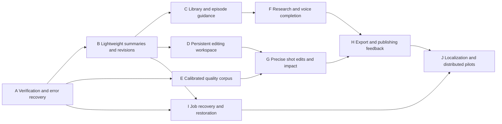

# YoutubeStudio development roadmap

Date: 16 November 2026. Based on the [current system review](SYSTEM_REVIEW_2026-11-16.md).

## Objective and planning assumptions

Make one episode easy to direct, verify, revise and export with traceable evidence, then connect it to publishing outcomes. Preserve the working production architecture, existing catalog, data and human approval boundaries.

This began as a proposed implementation plan. Dated implementation follow-ups below distinguish completed local work from remaining plans; the baseline table retains the original review observations. Effort ranges assume one experienced developer familiar with the repository, with a product/editor reviewer available for acceptance. Ranges are engineering effort, not calendar commitments; external account approvals and waiting for audience data are excluded.

The first 90-day planning window should prioritize A–F and a bounded G pilot. H–J are later milestones unless available capacity and measured needs justify pulling them forward.

## Baseline and intended results

| Outcome | Current evidence | Proposed acceptance target |
| --- | --- | --- |
| Trust the standard gate | Default coverage discovers old staging copies | Standard command passes with deliberately present scratch/staging material; real failures still fail |
| Understand a failed screen | Initial episode request errors leave only `Loading…` | Failed first request has localized error/retry; later failure visibly marks retained data stale |
| Browse a growing library | 58 states, about 75.4 MiB; full-document list reads | Indexed paginated summaries; rebuild/recovery tested from existing files |
| Reduce routine refresh work | Three large episode responses roughly 0.8–1.1 MB | Proposed status payload budget ≤25 KiB; heavy data fetched by panel/revision |
| Judge narrative quality | Historical score 4.99; no current comparable scored repeat pair found | Fixed corpus, human judgments, measured critic disagreement/noise and retained current render evidence |
| Complete source review | 316 claim candidates, zero sources/decisions in inventoried books | Pilot episodes have reviewed important claims with exact evidence or explicit unresolved decisions |
| Review dialogue | No voice-audit records in inventoried episodes | Pilot main/Short workflow discloses current stem checks and human listening status |
| Improve editing efficiency | Separate player, issues, script and shot panels | Five fixed editing tasks finish faster than measured baseline with no lost selections or hidden invalidation |
| Learn from publishing | Asset package exists; upload/results workflow absent | Accepted export linked to publication and manually entered/imported audience outcomes |

Payload and timing targets are design budgets to validate, not current guarantees. Establish repeatable measurements on a fixed host, production build and representative corpus before ratifying them. Do not use three loopback requests as a p95 benchmark.

## Sequence and dependencies

## A Restore trustworthy verification and visible failures

Priority P0. Effort 2–4 developer days. Start here.

Implementation follow-up, 16 November 2026: F01/F02 are fixed in the working tree.
Normal discovery is limited to owned test locations; initial polling errors have a
localized retry action, and later failures disclose stale retained data. The original
F02 proof now passes, with permanent client regression coverage. A timing-sensitive
player test now flushes its passive effect before checking unchanged seek/play
assertions. No timeout, worker count or coverage threshold was relaxed.

Final standard coverage passed 2,180 tests in 197 files, with the two opt-in storage
integration cases skipped and all four coverage metrics at 100%. Root/Studio types,
the default production build, 12 real-Git ownership tests, the isolated main/Short
quality workflow and a fresh 9.8-second real Remotion render passed. Browser visual acceptance remains unavailable because the
browser access host could not be reached. Socket warnings were traced to CLI entry
imports in the test harness; no production leak diagnosis or listener-limit change
is claimed. See the [review follow-up](SYSTEM_REVIEW_2026-11-16.md#implementation-follow-up)
for the complete evidence boundary. Build-worker experiments with lower overrides
remain optional follow-up; the unchanged default build passed serially.

Scope:

- Constrain Vitest discovery without reducing coverage or deleting retained audit material.
- Fix F02 initial polling failure disclosure; preserve abort, identity and unmount guards.
- Define a common UI state vocabulary: loading, refreshing, failed, stale, unavailable and retrying.
- Run local certification serially and retain source/environment receipts. Investigate build-worker settings through a controlled experiment after the load-sensitive failure.

Primary code: `vitest.config.ts`, `apps/studio/src/app/episodes/[id]/episode-view.tsx`, corresponding client tests and development/CI instructions.

Acceptance:

- Default coverage succeeds when an unrelated partial project copy exists in a scratch directory.
- A deliberately failing real source test still fails the standard command.
- The existing F02 proof is promoted into the normal client suite and seen red before the fix and green after it.
- HTTP 500, transport failure, eventual recovery, later stale data and unmount are covered with bounded deterministic tests.
- Root/Studio types, standard tests/coverage, release-ownership checks, Studio build and offline media gates pass on the final source snapshot.
- Build failures and skipped integrations are reported explicitly. Socket warnings are traced separately; listener limits are not increased to hide them.

## B Add rebuildable summaries and revision-aware reads

Priority P1. Effort 6–10 days. Depends on A.

Implementation follow-up, 16 November 2026: rebuildable summary manifests, bounded
Home pagination, list filters, compact status/revision reads, selected-panel payloads
and the JSONL snapshot cache are implemented in the working tree. Source states
remain authoritative and byte-compatible. Recovery and concurrent-publication
proofs cover missing/corrupt/pending indexes, external changes and restart. Live
progress estimates advance without forcing unchanged heavy panels to reload.
The database ledger retains its prior query path. A long-lived Studio process needs
a restart to install all new storage/cache capabilities; older singleton objects
remain functional through fallback. See the [B review follow-up](SYSTEM_REVIEW_2026-11-16.md#package-b-follow-up)
and [read contract](STUDIO_READS.md) for measurements and verification boundaries.
Library search/filter controls and editorial next-action guidance remain package C;
the query API alone does not complete that user journey.

Scope:

- Add a small episode summary manifest containing identity, display metadata, current production state, output availability and readiness counts.
- Make summary publication follow successful state persistence. Treat the manifest as a recoverable index, retaining existing state as the source of truth initially.
- Add list pagination, stable sorting and query filters.
- Introduce a lightweight status/revision response. Load script, shots, reviews and timeline only when needed and invalidate them by revision.
- Cache or incrementally aggregate ledger summaries with a defined update/rebuild contract. Retain the ability to reconcile with the append-only records.

Primary code: `packages/pipeline/src/actions.ts`, `pipeline.ts` save path, `apps/studio/src/app/api/episodes`, `lib/server.ts`, `packages/media-gateway/src/ledger.ts`.

Compatibility: existing JSON states and episode IDs continue to work without a destructive migration. A missing or stale index has an explicit recovery path. Do not introduce a second authoritative episode database by accident.

Acceptance:

- List requests no longer parse every full timeline-bearing state document.
- Corrupt/missing summary cases are disclosed or rebuilt without dropping valid episodes silently.
- Status responses remain within the proposed 25 KiB budget on the current largest fixtures.
- Unchanged polling avoids transferring unchanged heavy sections; late responses cannot replace newer revisions.
- Report cold/warm timings, bytes and memory at 50, 200 and 1,000 isolated fixture episodes. Use generated metadata copies, not paid media generation.
- Restart, concurrent save and index rebuild tests preserve ownership and visible progress.

## C Make the library and next action clear

Priority P1. Effort 4–7 days. Depends on B.

Implementation follow-up, 16 November 2026: the library now combines title/topic
search, status, series, resolved style, work queue and sorting in shared URL state.
Twenty-card pagination preserves these filters; KPI and cost scopes include the
whole matching set, not only the visible page. Media, agents and total costs are
separate; billed failures count and cached/orphan calls are excluded from cards.
Queue labels describe recorded approvals/outputs and explicitly do not claim
physical file health or publishing approval. Completed render records link to
inspection/export rather than implying editorial acceptance.

The next-action panel precedes collapsed, keyboard-accessible stage details and
discloses affected unfinished stages, approximate cost/time and paid/local work up
to the next unapproved gate. Opening a review or missing script does not start
generation. The creation form starts with the brief and basic settings, retains all
style options under expandable controls and offers recent-series preset buttons
without creation side effects. Explicit line-style presets are preserved too.

Browser access remains unavailable, so desktop/390-pixel visual and manual keyboard
acceptance are pending. Component/server tests and production HTTP checks are
reported separately in the [C follow-up](SYSTEM_REVIEW_2026-11-16.md#package-c-follow-up).
Do not interpret local implementation or line coverage as completed visual
acceptance or a measured improvement in editor task time. D remains the next
implementation package; collect the five-task baseline before its UX comparison.

Scope:

- Add search, production/approval/error filters, series and style filters, sorting and pagination to the episode library.
- Show an actionable queue: needs script review, concept review, preview review, failed, missing output and ready for export.
- Simplify the episode header to one primary next action with its affected work, estimated added cost and duration.
- Label media budget, agent usage and total cost consistently. State whether KPIs reflect the selected series or the whole library.
- Keep the 14-stage detail available in a compact expandable rail rather than making every stage equally prominent.
- Offer a brief-first creation path and series presets while preserving all advanced settings and 64 styles.

Acceptance:

- An editor can find the newest failed episode, the next pending approval and a missing output with a filter/search action instead of scanning the full library.
- Filter/query state survives refresh and shared links.
- The primary action matches the actual approval/stage contract and discloses paid versus local work accurately.
- Desktop and 390-pixel-wide acceptance includes long titles, empty lists, pending/errors and keyboard access.
- No generation is triggered by filtering, viewing presets or previewing costs.

## D Join playback, issues and inspection

Priority P1. Effort 8–12 days. Depends on B; coordinate with C.

Implementation follow-up, 17 November 2026: Shots now hosts the shared player,
inline shot/narration inspector and issue board. Overview issue selection loads that
workspace. Main, Short and code preview are explicit viewing sources; Short times
remain Short-relative and encoded evidence never silently seeks code preview.
Filters, current inspection and per-source positions survive episode-tab changes;
hidden playback pauses. Full reload persistence is outside this slice.

Unresolved navigation covers the current filtered 50-row page, with existing page
controls for the remaining records. Voice/research links focus their script scene.
Selecting a correction only prepares the shot and vector note; the existing priced
production action remains separate. Canonical export IDs bind playback and legacy
exports; stale stream requests receive 409. Producer-lock/finding checks remain
authoritative for decisions. Keyboard tabs and modal focus behavior have explicit
component coverage.

Browser access still returns an unavailable-host error. Production API/encoded
stream checks, component lifecycle tests and local build are separate from visual,
GPU-resource and manual accessibility acceptance. Human task-time sample size is
zero; no 30% improvement or completed visual acceptance is claimed. Use the five
tasks below on fixed episodes and both source revisions once a browser/editor is
available. Evidence boundaries are in the [D follow-up](SYSTEM_REVIEW_2026-11-16.md#package-d-follow-up).

Security preparation follow-up, 17 November 2026: the user approved the pending
dependency work. Next.js is pinned to 16.4.5; production and all-dependency registry
audits report zero known advisories. PostgreSQL/RustFS integration now also proves
real object-version publication and conditional writes on disposable services.
See [0.6.1 draft notes](releases/v0.6.1.md) and the
[dependency report](../security-report/dependency-audit.md). Publication remains
separate from this preparation; visual/editor acceptance remains pending.

Post-release follow-up, 17 November 2026: v0.6.1 is published with successful
main/tag CI. Windows Computer Use allowed a bounded desktop and 390×844 smoke
despite the unavailable in-app browser host. Running Studio already exposed the
new workspace; no restart was issued. Full keyboard/modal, mobile playback,
screen-reader, GPU and human task-time acceptance remain pending. See the
[publication and live verification](releases/v0.6.1-verification.md).

Scope:

- Build around the existing browser timeline player rather than introducing a second playback engine.
- Keep player, scene/shot navigation and inspector in one workspace.
- Link issue selection to the right player, output version, time and shot. Preview evidence and encoded-output evidence must stay distinguishable.
- Add next/previous unresolved issue, preserved filters and return-to-shot context.
- Make research and voice issues open the relevant script/scene context directly.
- Retain compact activity with detailed technical logs on demand.

Acceptance:

- A user can select an issue, seek, inspect the shot, decide and move to the next issue without losing playback/selection context.
- Main/Short timing is correct and an old decision cannot approve a new export.
- Repeated seeks and open/close cycles do not accumulate canvases, listeners or pending fetches on representative fixtures.
- Playback is evaluated in production builds; preview audio remains clearly distinct from final loudness processing.
- Verify dialog focus/escape, tab keyboard navigation, named controls, error announcements and mobile overflow.

Evaluate five fixed tasks before and after: locate a problem, seek to it, inspect its narration, record an accepted choice, and request a precise correction. A proposed target is at least 30% less median completion time without more errors; first collect a usable baseline and report the sample size.

## E Establish a calibrated quality corpus

Priority P1. Effort 5–8 engineering days plus editor review. Can begin after A while UI work proceeds sequentially as capacity allows.

Inventory follow-up, 17 November 2026: the immutable fixture passed all 153
referenced file hashes. Thirty historical stills and six clips are available;
the clips were probed and an unreviewed, byte-bound human-label packet was
prepared. All samples are Turkish and horizontal; human labels remain zero and
the historical run's source differs from 0.6.1. Explicit action/text/transition,
archive and portrait coverage still needs selection metadata. See the
[corpus readiness report](QUALITY_CORPUS_2026-11-17.md). This begins E preparation
without claiming calibrated quality gains or a fresh renderer baseline.

Engineering follow-up: the benchmark CLI now exports portable review galleries,
imports explicit byte-bound labels and reports append-only revision history.
Human and assistant coverage stays separate; branches and conflicting human
verdicts remain visible. This supplies the labeling mechanism, not the missing
human judgments, portrait/language supplement, fresh render or paid repeated
reviews. See the [review-packet workflow](QUALITY_WORKFLOW.md#export-and-label-a-benchmark-review-packet).

Scope:

- Reuse the frozen benchmark and immutable run format.
- Start with approximately 30 stills and 6–10 short clips, covering narrated actions, readable text, transitions, crowded scenes, close framing, archive inserts, representative style families and portrait crops.
- Add human labels for meaningful defects and accepted artistic choices. Keep annotation history and reviewer configuration identity.
- Use repeated scored runs only when separately authorized, since they incur model usage.
- Report missed issues, false alarms and score variability; separate technical checks from editorial judgment.

Acceptance:

- Compared runs use identical fixture inputs and compatible reviewer configuration, with current source identities.
- Missing samples, failed measurements and skipped semantic checks remain visible and cannot count as quality gains.
- A proposed source change shows representative before/after media and its cost/render-time effect.
- Versioned human labels explain why an intentional hold, monochrome style or emotional close-up is valid.
- Promotion criteria are calibrated against repeated-review noise; no invented absolute score improvement is required before a baseline exists.

## F Complete research and dialogue review in daily production

Priority P1. Effort 6–10 days plus editorial source work. Depends on C; use E for representative cases.

Scope:

- Add compact readiness counts and clear entry points for unsupported/stale claims and voice evidence.
- Make attaching a source excerpt to a narration span straightforward; show support, contradiction and uncertainty alongside the text.
- Keep changes to source/narration invalidating the relevant decisions.
- Offer a single local technical-preflight action that runs supported export/voice checks with explicit enabled/skipped disclosures.
- Provide an intentional listening checklist for names, dates, numbers, pauses and subtitle alignment.
- Keep factual review advisory initially; any blocker/waiver policy is an explicit editor choice with scope and version.

Acceptance:

- At least three representative pilot episodes complete the source/voice journey. Important factual claims are supported by reviewed excerpts or visibly unresolved.
- Exported research summaries identify the exact narrative revision; stale decisions do not survive changed evidence.
- A missing speech stem underneath audible music is detected; intentional word gaps remain valid.
- TR/EN editor strings exist and caption spelling remains distinct from pronunciation substitutions.
- No automatic research claim implies that a tool-free runtime agent browsed or verified a page.

## G Add precise shot changes with impact previews

Priority P2. Effort 10–15 days for the bounded first slice. Depends on D and E.

First slice: supported text labels, existing camera values, readable hold/timing constraints and selected assets. Additional geometry controls require their own acceptance cases.

Scope:

- Reuse narration-edit fingerprint and undo patterns.
- Introduce explicit editor overrides with stable shot identity and a defined relationship to later replanning.
- Preview affected scenes, voice, shots, exports, cache reuse and estimated extra work before applying a change.
- Keep saved previous revisions and their output evidence navigable.

Acceptance:

- A label correction does not redraw an unrelated character or resynthesize unchanged narration.
- Advertised invalidation matches actual work and a stale preview is rejected.
- Replanning either preserves an explicit override or visibly explains why it needs reconciliation.
- Undo restores the expected saved revision without overwriting a concurrent change.
- Old output evidence stays historical, and current export decisions remain version-bound.

Do not start with a general nonlinear editor or an unrestricted animation property grid. Add supported controls in independently verifiable slices.

## H Close the export and publishing feedback loop

Priority P2. Effort 5–8 days for manual workflow; authenticated integrations estimated separately. Depends on F and a bounded G pilot.

First deliverable:

- A versioned export manifest for main video, Short, thumbnail, subtitles, metadata and review disclosures.
- A clear export checklist and visible local file-health state.
- Manual published URL/channel/date entry tied to the accepted output.
- Manual or file-based import of audience metrics, with source dates and immutable snapshots.
- Compare production cost and editor effort with actual audience outcomes; avoid inferring causation from a few videos.

Acceptance:

- The files, metadata and decisions in a package all identify the same accepted output version.
- A failed/absent required file is disclosed before export completion is claimed.
- Duplicate/partial audience imports reconcile predictably and retain provenance.
- A series can review its published episodes, effort/cost and subsequent observed results in one view.

Later slices: credential storage, upload/scheduling, platform errors, token refresh and analytics collection. Verify current platform requirements from official documentation at implementation time. These are not implied by this roadmap or existing schemas.

## I Make local jobs and assets recoverable

Priority P2, promoted when operational incidents justify it. Effort 8–12 days. Depends on A/B.

Scope:

- Persist job identity and state transitions: requested, starting, running, cancel requested, cancelled, failed and complete.
- Reattach Studio to an existing local producer after restart using persistent ownership evidence.
- Acknowledge cancellation only after bounded process/resource checks; cover child/grandchild cleanup explicitly.
- Write a manifest-based backup/restore rehearsal for episode state, decisions/research/revisions, shared library and required media.
- Design reference-aware retention with dry-run reports before any deletion feature.
- Reproduce or dismiss the busy-check/delete/start interval in an isolated gated lifecycle test before changing deletion ownership.

Acceptance:

- Kill/restart Studio during an isolated render; production state and job visibility reconcile correctly.
- Repeat cancel/resume under controlled completion order; late work cannot overwrite a newer owner.
- Restore a representative episode and shared assets to a fresh store and produce a valid local render.
- Cleanup never deletes an asset referenced by an active or retained revision; dry run explains each candidate.
- No unrelated host processes, project services or user data are touched by the exercises.

## J Expand languages, workers and engines only with evidence

Priority P3. Separate estimates after A–I pilots.

Localization pilot: one source episode into two additional languages, measuring duration differences, captions, name pronunciation and layout. CJK/RTL require real font/shaping and readable-frame acceptance before broader language promises.

Distributed pilot: durable queue, host capability declaration, global budget/resource policy, leases/fencing, staged output ownership and recovery after a worker disappears. Prove this on disposable media before moving a production episode.

External-engine pilot: choose one narrative need that current native scenes cannot satisfy. Declare native/hosted/media editability and provide staged assets, readiness, caching, cost/error behavior and actual integration evidence. Keep the existing HyperFrames development fixture labeled accurately.

Provider optimization pilot: compare configured adapters on fixed accepted tasks with price/latency/failure and editor-acceptance outcomes. Retain the gateway as the sole production interface. New providers and model versions are independent verification work.

## First 90-day working plan

| Window | Planned focus | Exit decision |
| --- | --- | --- |
| Weeks 1–2 | A; capture editor task baseline; start B design and recovery contract | Standard gate trustworthy; F02 fixed; baseline and explicit summary contract reviewed |
| Weeks 3–4 | B and the first C slice | Summary/list/status reads meet the agreed budgets on fixed fixtures |
| Weeks 5–7 | Finish C; D playback/issue pilot; E human calibration | Editors complete the five tasks reliably; quality claims have a current corpus basis |
| Weeks 8–10 | F on three representative episodes; bounded G controls | Source/voice review actually completed; label/camera corrections have truthful impact previews |
| Weeks 11–13 | Stabilize pilot; G completion or H manual publishing slice; I design/rehearsal as capacity permits | Measure time/cost/escape rate; choose the next bottleneck from evidence |

The listed efforts overlap in capability but are not an instruction to spawn agents or run shared-state tests concurrently. If one developer's measured capacity cannot fit the window, finish A–F and defer G/H rather than weakening acceptance gates. Increase staffing or extend the calendar only through an explicit planning decision.

## Metrics and review cadence

Record one row per episode/export revision: source identity, style/mode/language, target/actual duration, stage timings, media and agent cost, cache reuse, regeneration count, editor time, issue decisions, source/voice/export evidence and eventual publication results.

Review weekly:

- Median time from brief to accepted export and active editor time.
- Cost per accepted minute, separately showing agents, media and failed attempts.
- Time/actions required for the five fixed editing tasks.
- Meaningful defects found after acceptance and reviewer false alarms on the labeled corpus.
- Percentage of pilot exports with current main/Short, source and voice disclosures; skipped is a separate category.
- Failed-job recovery time, missing-output counts and restore rehearsal status.

Do not turn the historical mean critic score or percentage of covered lines into the sole product KPI. Compare like inputs and versions, preserve uncertainty and report the denominator.

## Per-package completion gate

Each implementation package must deliver a scoped change, relevant red/green behavior evidence, final source identity, updated TR/EN UI strings where applicable, current documentation and an explicit compatibility/recovery story. Use the repository's normal types/tests/coverage and production build, plus real no-generation media checks for changes touching rendering, assets or export evidence.

Hosted CI, local certification, deployed workers, authored media delivery and live audience results remain separate claims. A local fixture, exported project or screenshot cannot substitute for an unrun gate.

## Work deliberately deferred

- Another large style-pack expansion before representative existing styles are measured.
- A wholesale orchestration/render rewrite or a new authoritative database without a migration need.
- Automatic paid regeneration from every critic finding.
- Multi-channel scheduling, many-language production and distributed rendering before one production journey is measurable.
- Automatic factual approval from an agent-generated claim list.
- Background asset deletion without a reference-aware plan and restore proof.

These boundaries preserve development capacity for the workflow improvements with the clearest evidence of value.
