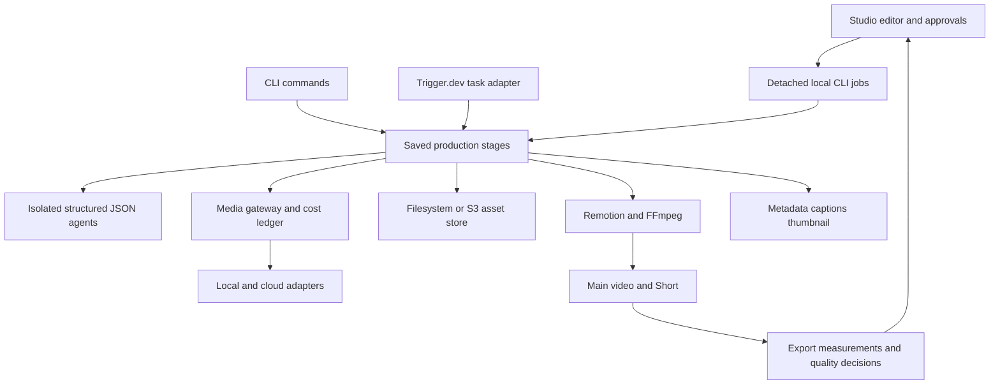

# YoutubeStudio system review

Date: 16 November 2026. Baseline: `653ad8082a53de70370cc85e2843e3f3246834c6`, version 0.6.0.

The review covers Studio, CLI, worker, all seven packages, local production records, verification, editorial workflow and product direction. Existing changes were `.claude/settings.json` deleted and `apps/studio/tsconfig.json` modified. They were preserved. This review adds documentation and local evidence; it applies no production fixes.

## Assessment

The system already has a capable production foundation. Its main constraint is turning its separate capabilities into a reliable daily editing workflow. The next investment should make the next action obvious, connect quality findings to playback and precise edits, and establish a repeatable editorial benchmark.

Three decisions should guide the next development cycle:

1. Make normal verification trustworthy and recoverable errors visible before expanding functionality.
2. Improve the existing vector production workflow and evidence adoption before expanding the style catalog or introducing another production engine.
3. Complete one measurable journey from brief to reviewed export and audience feedback before scaling to more workers, channels or languages.

The current system can produce media and has strong automated coverage. That does not establish that the average episode tells its story clearly, that its narration is factually supported, or that its output performs well with viewers.

The implementation sequence and acceptance gates are in the [development roadmap](ROADMAP_2026-11-16.md).

Implementation follow-up: F01/F02 below describe the original audit baseline. Their
fixes and subsequent checks are recorded under [Implementation follow-up](#implementation-follow-up).

## Evidence and limits

The review combined source inspection of critical entry points and contracts, an inventory across all ten workspace units, current local records, tests, builds, real HTTP reads, one desktop UI observation, and isolated encoded-media checks. It was not a line-by-line review of every source file.

The inventory indexed 259 non-test TypeScript/TSX files and 204 test-directory files across the three apps and seven packages. Counts include workspace configuration and scripts where they fall under these directories; they are not executed-test counts.

Evidence labels used below:

| Label | Meaning |
| --- | --- |
| Reproduced defect | A current command or controlled behavior fails, with an identified trigger |
| Observed condition | Measured current data or an operational result, without an established defect cause |
| Source concern | A reachable implementation deserves improvement or a dedicated proof; not presented as a confirmed bug |
| Proposal | A future product or engineering decision with acceptance criteria |

Local evidence is retained under `.temp_files/system-review-2026-11-16/`. This directory is Git-ignored; logs and media are local evidence rather than portable release artifacts.

The normal browser connection reported `The browser access host is unavailable`. Native-window fallback displayed the live desktop script-review screen. Further navigation stopped when the tool detected user input in that window. Mobile layout, keyboard-only journeys, screen-reader behavior, player smoothness and a complete browser journey were not validated in this review. HTTP success is not visual acceptance.

## Current architecture and maturity



Stages remain `style → story → script → cast → concept → voice → shots → keyframes → clips → timeline → render → package → short → review`.

| Area | Current implementation | Main remaining constraint |
| --- | --- | --- |
| Studio | TR/EN interface, series, character selection, script edits, approvals, shots, live player, audits and issue decisions | Capabilities are spread across tabs and expandable panels; data refresh still sends large episode objects |
| CLI | Production, regeneration, diagnostics, audits, benchmarks and library commands | Operational detail is useful but recovery and evidence are not presented as one editor journey |
| Worker | Trigger.dev adapter, retries, concurrency limit and progress metadata | Deployment and distributed restart behavior were not exercised; Studio still launches local CLI children |
| Core | Shared schemas, styles, typography, intent, claims, geometry and rules | Cross-layer lifecycle and version contracts need to remain explicit as features grow |
| Agents | Structured story, writing, design, direction, critique, packaging and pronunciation calls | Still critiques and self-declared intent cannot establish complete temporal or factual quality |
| Gateway | Routing, estimated prices, cache, health tracking, reservations and billed-failure accounting | Configured quality priors are not an empirical provider leaderboard; live integrations were not exercised |
| Pipeline | Idempotent stages, incremental saves, approval invalidation, reuse, revisions and export evidence | A 3,307-line orchestration file carries many stage and recovery responsibilities |
| Video | Remotion, SVG rigs, Three.js/PixiJS, chunk cache, audio mixing, render lock and retries | A 3,946-line vector component and engine variation increase the cost of visual regression analysis |
| Storage | Filesystem/S3 interface, atomic writes and conditional ownership | Library listing still discovers and reads full state documents; cross-host lock recovery needs a separate distributed contract |
| Database | PostgreSQL ledger and schema for broader channel/episode concepts | Schema presence does not mean the production repository has migrated from file/object state |
| Publishing | Metadata, chapters, tags, thumbnail, subtitles and Short | No implemented YouTube upload/scheduling or audience-results loop was found in the inspected app entry points |

Source anchors: [Studio jobs](../apps/studio/src/lib/server.ts), [pipeline](../packages/pipeline/src/pipeline.ts), [stage state](../packages/pipeline/src/state.ts), [worker](../apps/worker/src/episode.ts), [agent runner](../packages/agents/src/runner.ts), [gateway](../packages/media-gateway/src/gateway.ts), [renderer](../packages/video/src/render.ts), [storage](../packages/storage/src/index.ts), [database schema](../packages/db/src/schema.ts).

## What has advanced since the previous review

Several recommendations from [11 November](SYSTEM_REVIEW_2026-11-11.md) are now implemented and should be improved through use rather than requested again as new features:

| Earlier direction | Current source evidence | Work still needed |
| --- | --- | --- |
| Fixed quality corpus | Frozen fixture, source/reviewer identity and technical clips | Current scored repeatability and human calibration |
| Export-bound issue decisions | Paginated issue board, historical decisions, main/Short identities | Faster discovery and a unified playback/editing workflow |
| Structured narrative intent | Subject/action/target/payoff/narration/reveal/hold schema and checks | Adoption and measured temporal/semantic validation |
| Factual sources | Source/claim records, stale decisions, editor excerpts and frozen export summaries | Actual source collection and human resolution of claims |
| Precise narration edits | Impact preview, retained audio, stale application checks and revision undo | General shot-property editing and broader dependency previews |
| Independent dialogue checks | Voice stem audit and pronunciation dictionaries | Routine use, listening-based validation and separately validated intelligibility checks |
| Playback before rendering | Same Remotion episode component in the browser, shot seeking and asset streaming | Edit-side playback context, error recovery and multi-format visual acceptance |

Relevant guides: [quality](QUALITY_WORKFLOW.md), [intent](SHOT_INTENT.md), [claims](CLAIM_SOURCES.md), [editing](NARRATION_EDITS.md), [voice](VOICE_AUDIT.md), [pronunciation](PRONUNCIATIONS.md), [Studio](STUDIO.md).

## Current local production evidence

These are fresh read-only counts of the local filesystem library. They include historical and development episodes and do not represent published-channel statistics.

| Measure | Observed value | Interpretation |
| --- | ---: | --- |
| Episode state files | 58 | All 58 parsed successfully |
| Combined state bytes | 79,100,744 | Approximately 75.4 MiB |
| Render records | 56 | A state reference is not a file-health check |
| Referenced main files present | 54 | Two older referenced files were absent |
| Main video bytes, present references | 11,926,851,538 | Approximately 11.1 GiB; excludes caches, working media and other output classes |
| Short records / files present | 2 / 2 | Portrait workflow exists but adoption in this library is limited |
| Main audit records | 11 | Presence only; not a count of complete or current passing audits |
| Short audit records | 0 | Historical library adoption gap; the isolated current Short fixture passed |
| Voice audit records | 0 | Feature availability has not translated into recorded use here |
| Style comparison records | 0 | No measured reference-comparison adoption in this inventory |
| Planned shots | 2,427 | Representative material for an editing and quality corpus |
| Shots with structured intent | 297 | Approximately 12.2%; legacy plans intentionally remain compatible |
| Stored final shot reviews | 2,201 | Historical critic outputs across versions |
| Mean stored review score | 4.99/10 | Diagnostic history, not a new score of current rendering code |
| Research books | 8 | Source/claim workflow is available |
| Claim candidates / source entries / reviewed claims | 316 / 0 / 0 | Candidate extraction is being used without the source-review completion step |
| Explicit motion modes | 55 vector, 1 still, 2 legacy | Vector is the practical first optimization target |
| Built-in style packs | 64 | Preserve the catalog; validate representative families before expanding it |

The missing main-file references belong to `2026-10-29-render-demo-28eb4d` and `2026-10-30-hesap-makinesinden-dogan-ilk-mik-335ef7`. Their absence does not establish a storage defect or accidental deletion. A health view should let the editor distinguish archived, relocated, missing and current outputs.

The most frequent historical issue occurrences were `other` 1,190, `off_story` 1,115, `wrong_scale` 703, `empty` 518, `repetitive` 452 and `character_cut_off` 395. A shot may have multiple issues, and earlier findings may have been addressed by later code. The large `other` category deserves a clearer taxonomy and reviewer calibration; these counts cannot establish current defect rates.

Four benchmark run records were found. The provenance-bearing November baseline contains 30 rendered stills and six clips, with `reviewStatus: skipped`. The older three lack the inspected comparability fields. No current completed scored repeat pair was found in these records. This review did not pay for a new critic run or rerender the complete frozen corpus.

Collector: `collect-evidence.mjs`; aggregate result: `evidence.json`; benchmark inventory: `production-probes.json`, all in the local evidence directory.

## Reproduced defects

### F01 Standard verification collects old staging tests

Priority: P0 for verification reliability. Classification: test-discovery defect, not a demonstrated production failure.

Trigger: run the documented `pnpm.cmd test:coverage` in this existing checkout, which contains an old partial source copy under `.temp_files/hosted-ci-2026-11-12/staging/`.

Actual result: four test files fail. Three cannot resolve modules/packages, and the copied release suite has 12 failing tests. Meanwhile 197 actual workspace test files pass. The configured runner does not exclude temporary staging directories: [vitest.config.ts](../vitest.config.ts).

Control: `pnpm.cmd exec vitest run --coverage --exclude=.temp_files/**` passes 197 files and 2,174 tests, with one integration file/two tests skipped and all four coverage measures at 100%.

Impact: a preserved audit workspace can make the standard local gate fail for reasons unrelated to current production code. Requiring developers to delete their evidence would be the wrong recovery policy.

Recommendation: constrain discovery to owned source test locations, or extend the runner defaults with explicit scratch/output exclusions. Preserve the 100% thresholds and verify both a clean checkout and a checkout containing a synthetic staging copy. Vitest documents that CLI exclusions are additive while configured exclusions replace defaults unless explicitly extended: [official exclude reference](https://vitest.dev/config/exclude).

Evidence: `coverage.log` and `coverage-scoped.log`. The first run occurred before this review added its own proof. The new proof uses a `.proof.ts` suffix and explicit configuration so default discovery does not collect it.

### F02 Initial episode polling failure leaves only a loading message

Priority: P1. Severity: Medium. Classification: reproduced UI error handling defect.

Locations: [episode-view.tsx](../apps/studio/src/app/episodes/[id]/episode-view.tsx), `refresh`, the poll catch and the initial `!data` branch, approximately lines 27–64 and 112.

Trigger: the page has mounted, but each initial episode-data request returns HTTP 500. This can occur after server rendering succeeds and a subsequent ledger/storage/API request fails. It is separate from directly opening a nonexistent episode, which the server page already handles.

Actual result: after four completed failed requests over 15 seconds of deterministic fake time, the component displays only `Loading…`. There is no visible error/retry status. Non-OK responses do not update data or the displayed error, and poll exceptions are swallowed.

Control: the same mounted component with a successful response displays the episode heading.

Reproduction:

```powershell
pnpm.cmd exec vitest run --config .temp_files/system-review-2026-11-16/proof.config.ts
```

Result: one control passes, one expectation fails, and the proof prints `PROBLEM CONFIRMED`. The failed assertion checks visible behavior, not implementation text.

Recommendation: show a localized connection/error state after a failed initial request; offer retry; retain useful data on later failures while visibly marking it stale. Preserve existing abort, sequencing and unmount safeguards. Do not expose raw secret-bearing transport errors.

Evidence: `prove-poll-error.proof.ts`, `proof.config.ts`, `prove-poll-error.log`. No fix was applied.

## Operational observations and source concerns

### O01 Build resource behavior depends on concurrent load

The first production build compiled and typechecked, then attempted page-data collection with 31 workers and terminated with native V8 `Zone Allocation failed - process out of memory`, exit 134. Coverage and the development server were also active.

A serial rerun of the identical `pnpm.cmd studio:build` passed. This establishes a load-sensitive operational failure in this session; it does not establish a deterministic application leak or prove worker count as its sole cause. Intermittent shell process creation also returned OS error 5 during the session; no common root cause was proven.

Recommendation: serialize heavyweight local certification stages, record build-worker/resource settings, and test a supported worker limit on the same host before changing defaults. Increasing heap limits alone is not established as a repair.

Evidence: `studio-build.log`, `studio-build-serial.log`. Existing render concurrency safeguards should be preserved.

### O02 Small list responses still require full state reads

[EpisodeRepo.list](../packages/pipeline/src/actions.ts) enumerates episode storage and reads state documents four at a time, dropping `timeline` only after parsing. [Home](../apps/studio/src/app/page.tsx) also reads the full cost ledger. In JSONL mode, [ledger.list](../packages/media-gateway/src/ledger.ts) reads and parses the whole file.

The existing bounded batches prevent an unbounded simultaneous memory load. They do not create a list index. This is a scaling concern supported by source and current observations, rather than a claimed performance regression against a historical baseline.

Three production-server loopback samples per route returned:

| Route | Response body bytes | Observed elapsed time |
| --- | ---: | --- |
| Home | 385,075 | 1,072–1,291 ms |
| Episode list API | 22,223 | 549–652 ms |
| One 192-shot episode API | 825,593 | 52–492 ms |

The three large episode API samples collected earlier were 825,593, 1,065,386 and 986,668 bytes. None contained `timeline`, confirming that the earlier payload repair is present. The polling component nevertheless requests a full response every five seconds when idle and 1.5 seconds while running; it schedules the next request after completion.

A 1 MB body every five seconds is roughly 12 MB per minute before transfer compression, even when the episode is unchanged. This is arithmetic illustrating payload pressure, not measured network traffic. Response samples had no ETag; this review did not measure browser transfer compression.

Recommendation: introduce a revisioned lightweight status response; fetch script/shots/reviews on demand; serve lists from a rebuildable summary manifest with pagination. Keep a recovery path that rebuilds the summary from existing state. Measure production builds with fixed corpus sizes before setting final latency budgets.

Evidence: `evidence.json`, `production-probes.json`. Development compilation times were also recorded but are not production performance evidence.

### O03 Available evidence does not yet form an editorial release decision

Current technical checks correctly distinguish measurements from editorial approval. Preserve that boundary. The local archive shows low adoption of voice audits, Short audits, measured style comparison and resolved source records.

The 316 unreviewed claim candidates with zero source records are especially actionable. Candidate extraction does not verify the narration. The right next step is an editor-facing completion workflow with supplied excerpts, disagreements and clear unresolved status. The runtime JSON agents must remain tool-free.

Recommendation: add an episode readiness summary combining separate factual, voice, visual, export and publishing states. Start advisory; introduce any blocking policy as an explicit product setting with a recorded human decision, rather than silently changing existing approval behavior.

### O04 Error handling and status semantics vary between panels

The episode view now has good cancellation/sequencing safeguards, while [character-bank reload/post](../apps/studio/src/app/characters/character-bank.tsx) and [estimate refresh](../apps/studio/src/app/new-episode-form.tsx) use less consistent error, timeout and freshness handling. The estimate request has no response-identity guard, so out-of-order replies deserve a dedicated proof before a defect claim.

The Home series view filters episode/video/running counts, while its spend KPI sums the complete episode ledger. Its label says `Total spend`. Clarify whether that value is global or filtered; this is a product-semantics concern, not a proven accounting defect.

Recommendation: standardize observable pending, failed, stale, unavailable and retry states. Preserve inputs and selection when a request fails. Add focused behavior checks for races and network failures when each affected panel is changed.

### O05 Distributed execution and recovery remain separate work

Studio job handles/logs are process-local and launch detached CLI children. Pipeline state and ownership locks persist, so a Studio restart does not automatically mean production progress is lost. However, durable job identity, reattachment, cancellation acknowledgement and a complete restart-recovery journey need their own acceptance test.

The [episode lock](../packages/pipeline/src/lock.ts) deliberately treats another host's lock as live. This is conservative ownership protection, but it means automatic recovery after a remote host disappears is not solved by local PID checks. Before distributed execution, define leases, fencing, output ownership and explicit recovery. Do not replace current fail-closed behavior with blind expiry.

The DELETE route checks busy state before deleting local/store files without holding the producer lock across the whole operation. A concurrent external producer starting in that interval deserves an isolated lifecycle proof. This review did not reproduce a deletion race and does not report data loss.

### O06 Maintainability should follow measured change boundaries

Large files are not defects by themselves. The largest behavioral modules are `Vector.tsx` (3,946 lines), `pipeline.ts` (3,307), Studio `steps.tsx` (1,005) and `render.ts` (606). Isolate stage orchestration, job lifecycle, evidence collection and render planning when they are already being changed. Preserve old episode and timeline compatibility with representative fixtures. Avoid a wholesale rewrite to make files shorter.

## Interface review and proposed editor experience

The observed desktop script screen has a coherent dark palette, readable panels, visible approval status, an explicit next action, pipeline progress and separate API/Claude spend. Preserve these strengths.

The visible screen simultaneously presents a 14-stage rail, live event panel, six tabs, three expandable evidence sections and a long sequence of narration editors. The primary action appears both as a general review prompt and as a script approval. On the inspected wide display it was readable; mobile behavior and keyboard focus were not inspected.

The main design opportunity is a clearer task hierarchy, with detail available when needed.

| Surface | Proposed improvement | User outcome |
| --- | --- | --- |
| Episode library | Search, status/series/style filters, sorting, pagination, pending approvals and explicit missing-output state | Find the next episode needing attention without scanning every card |
| New episode | A short brief-first path; series defaults and a few proven presets; advanced controls behind disclosure | Start confidently without losing the existing advanced options or catalog |
| Episode header | Title, current stage, one primary next action, cost/time impact and compact readiness counts | Understand what to do and what it changes |
| Script | Scene list beside narration; sources attached to the relevant sentence; visible unresolved counts | Review the claim while reading the line it supports |
| Shots | Persistent player with scene/shot navigation and a property inspector | Inspect, seek and make a precise change in one context |
| Quality | One issue list linked to the same player and exact output version; saved filters and next unresolved issue | Turn a finding into an editorial decision or edit |
| Regeneration | Before/after revision, affected scenes/voice/outputs, cache reuse and estimated added cost | Choose the smallest useful regeneration |
| Activity | Compact current step and recent meaningful events; technical detail on demand | Recover from an error without reading every log line |
| Export | Readiness disclosure, current main/Short assets, metadata and an export checklist | Know which files and evidence belong together |

A proposed desktop composition is:

```text
Episode title | current state | readiness | primary action
Scene and shot list | persistent preview player | inspector
                    | narration and timing      | issue or edit
Compact playback timeline and unresolved-issue navigation
```

On smaller screens, use player → current issue/inspector → scene navigation, with a reachable primary action. Keep advanced technical activity out of the primary editing space. Retain the existing dark visual identity; a cosmetic redesign alone would not address the workflow gaps.

Accessibility acceptance should include named icon controls, visible keyboard focus, predictable modal focus/escape behavior, tab keyboard navigation, non-color status cues, touch targets and readable error announcements. Existing dialog keyboard handling should be reused and tested rather than assumed absent. Measure actual task completion on desktop and a narrow viewport before claiming the new layout is better.

## Quality and production direction

**Narrative quality:** improve the match between narrated subject, action, visible result and readable hold. Use structured intent as the planning contract and actual clips as the verification surface. Do not award success because the agent wrote the desired payoff into metadata.

**Style quality:** keep all 64 packs. Choose representative style families actually used in production and test composition, materials, typography, motion and 9:16 behavior. Expand coverage from measured failures. Another catalog expansion is lower priority than making existing families visibly distinct and consistent.

**Review quality:** use a frozen corpus with current source/prompt/reviewer identity, human labels and repeat runs to estimate critic noise. Track false alarms and missed meaningful issues. Split broad `other` diagnoses only where reviewers can distinguish them consistently.

**Voice:** make stem audits easy to run from the current script; preserve intentional gaps and caption spelling. Add real listening samples for pronunciation, numbers and names before making intelligibility claims. Mixed-audio energy cannot prove audible dialogue.

**Research:** move from claim collection to evidence completion. Keep exact source excerpts, their dates and quote anchors, disagreement, stale decisions and export snapshots. Any future fetch/research process should be an explicit bounded job that stages evidence for the existing isolated agents.

**Costs:** preserve gateway ownership, caching, integer micro-dollars and accounting for billed failures. The media budget deliberately excludes Claude agent costs. Improve warnings and forecasts while retaining this decision; do not silently introduce an agent hard cap. Compare estimated and observed cost by stage, model, style and accepted export.

**Reliability:** add restart/cancel/retry and restoration exercises in disposable stores. A backup plan should cover state, research/decisions/revisions, shared library, generation cache and outputs with distinct retention policies. Host backup coverage was not inspected. Any future cleanup needs a reference-aware dry run and recovery story.

**Publishing:** first make manual export and channel-result recording easy. Attach a published URL and version identity, then import or enter measured results. Only after that add credentialed upload/scheduling and automatic analytics as separate work packages. Do not infer such capabilities from channel schemas.

**External engines:** preserve native Remotion editing as the production path. The HyperFrames exporter remains a development fixture. Automatic external-engine jobs require staged assets, readiness, caching, costs, failure handling and integration proof. Installed authoring skills do not load into runtime agents.

## Validation performed

Environment: Windows, Node.js 26.13.0, pnpm 11.25.0, Vitest 5.0.5, Next.js 16.4.3, FFmpeg/ffprobe 9.0.2.

| Check | Result |
| --- | --- |
| `pnpm.cmd typecheck` | PASS, root and Studio |
| `pnpm.cmd test:coverage` | FAIL: four copied staging test files; 12 failed tests, 2,174 passed, two skipped |
| `pnpm.cmd exec vitest run --coverage --exclude=.temp_files/**` | PASS: 197 files, 2,174 tests; one integration file/two tests skipped |
| Source-only coverage | Statements 17,128/17,128; branches 12,982/12,982; functions 3,818/3,818; lines 13,256/13,256 |
| `pnpm.cmd exec vitest run --config vitest.release.config.ts` | PASS: 12 checks against disposable Git repositories |
| `pnpm.cmd studio:build` | First attempt FAIL, exit 134 under concurrent load; identical serial rerun PASS |
| `pnpm.cmd --silent ys doctor --json` | PASS required checks; optional Manim warned; provider connectivity and ComfyUI skipped |
| `pnpm.cmd quality:preview .temp_files/system-review-2026-11-16/quality-fixture` | PASS: real main/Short audit, persisted decision, isolation from another export, zero ledger entries |
| Existing offline `render-demo`, preview approval, `episode run ... --only render` in isolated store | PASS: real Remotion MP4, 1920×1080, 30 fps, 9.8 seconds, H.264/AAC; audit complete, zero findings, zero generation ledger bytes |
| Production HTTP | PASS sampled home/list/episode routes; hostile Host 403; cross-site write 403; missing episode API 404 |
| F02 behavior proof | EXPECTED FAILURE: successful control passes; initial-error disclosure expectation fails |
| Desktop visual observation | PARTIAL: live script-review screen observed; no complete interaction journey |

The standard suite emitted `MaxListenersExceededWarning` for sockets. This is a warning requiring a focused trace before any leak diagnosis. Assertions or listener limits were not changed.

The first attempted hostile Host probe used Fetch and returned 200; that attempt did not establish that the intended Host reached the server and is inconclusive. A separate production probe using Node's HTTP request with an explicit Host returned 403. Only the latter supports the Host-guard result.

The real MP4 SHA-256 is `b8b26d66984f283ab114477054737ed106ee57f04207f982a6a0289e788706d6`; details are in `media-receipt.json`. It is a synthetic still-motion production-path smoke test, not proof of all 64 styles, real narration quality or a delivered authored episode.

### Not run

- Paid provider generation, paid critics, account authentication and provider price refresh.
- Native PostgreSQL/RustFS integration: dedicated project services were not running; another project's PostgreSQL already occupied port 5433. No shared service was changed.
- Hosted CI, release, deployment, channel upload or audience analytics.
- Complete current-corpus benchmark, semantic clip evaluation, full-episode listening or independent factual verification.
- Full mobile/keyboard/browser flow, all-style visual matrix, production player performance or cross-host worker recovery.
- Dependency/security penetration audit or exhaustive source review. The two HTTP boundary probes are narrow checks, not a security certificate.

## Recommended order

Start with F01/F02 and a reproducible local verification path. Next create the lightweight summary/readiness layer and improve the episode library/header. Then join playback, issues and precise edits, while running a human-calibrated benchmark and completing source/voice review on representative episodes. Add publishing feedback and operational recovery before scaling channels, languages or engines.

Success should be measured by time to an accepted export, editor actions per correction, repeated generation cost, current evidence completion, and meaningful defects escaping review. Test coverage remains a necessary engineering gate; it is not the editorial success metric.

## Implementation follow-up

16 November 2026, roadmap package A, working tree based on the same HEAD:

- **F01 fixed:** normal Vitest discovery now includes the owned workspace test
  directories and root scripts. Old staging copies remain on disk. The executable
  discovery verifier finds a real source sentinel, excludes scratch copies, and
  confirms that a deliberate real source assertion still exits 1.
- **F02 fixed:** the episode screen shows a safe TR/EN error and retry action after
  an initial failure. Later failures retain the episode with a stale warning.
  Successful refresh clears it; manual retry resets the poll schedule. Existing
  request cancellation and generation guards cover both late successes and errors.
- The unchanged original F02 proof now passes both cases. Permanent tests cover
  HTTP, malformed JSON, transport failure, timeout, recovery, pending manual retry,
  stale data and obsolete failures. The client test count rose from 21 to 27.
- A full-run player test exposed an effect-timing assumption: DOM visibility did
  not guarantee its seek/play passive effect had run. The test now flushes React
  effects before the same assertions. Player production code is unchanged.

| Final check | Observed result |
| --- | --- |
| `pnpm.cmd typecheck` | Root and Studio pass |
| `pnpm.cmd test:coverage` | 197 files and 2,180 tests pass; one integration file/two cases skipped; no exclusion flag |
| Coverage | Statements 17,140/17,140; branches 12,994/12,994; functions 3,819/3,819; lines 13,266/13,266 |
| `pnpm.cmd studio:build` | Pass with unchanged default 31-worker page-data collection |
| Real-Git release ownership | 12 tests pass |
| Isolated main/Short quality fixture | Both audits complete; decision/version isolation passes; zero ledger entries |
| Fresh isolated Remotion demo | 9.8 seconds, 1920×1080 at 30 fps, H.264/AAC; audit complete with zero findings; zero generation ledger bytes |

An earlier implementation coverage run had two failures: a 30-second anatomy-test
timeout under test load and the player effect assertion above. Both unchanged test
files passed all 204 behavior tests in a one-worker instrumented diagnostic run;
that selected run did not satisfy full-project coverage thresholds. After the player
test synchronization correction, the complete standard suite passed with the
original four workers, 30-second limit and 100% thresholds. No anatomy implementation
or assertion was changed.

Socket warnings persist. `--trace-warnings` points to `surviveBrokenPipe` at
`apps/cli/src/pipes.ts:11`, invoked from the repeatedly imported CLI entry in the
Vitest evaluator. This locates the warning during tests; it does not establish a
production memory leak. Listener limits were not increased.

Evidence is retained under `.temp_files/roadmap-a-2026-11-16/`, including the before
proofs, discovery/failure control, final coverage summary, media and `receipt.json`
with source/media hashes and gate logs. Visual
browser acceptance, hosted CI, paid integrations, PostgreSQL/RustFS and worker
deployment were not run. A lower Next.js worker override was inspected in installed
source and documented as a possible experiment; it was not adopted or certified as
a fix. Existing dirty settings/tsconfig and previous report changes were preserved.
No commit, push or release was performed.

## Package B follow-up

16 November 2026, working tree based on the same HEAD, after package A:

- Episode lists and Home now use a rebuildable, versioned summary manifest. Home
  shows 20 records per page; query APIs support bounded pagination, sorting, text,
  series and production-status filters. Existing full-state readers remain
  compatible. Missing, corrupt or stale summaries rebuild from authoritative
  state; unfinished/unreadable records are disclosed rather than silently dropped.
- Compact status/revision polling loads heavy data only on a changed revision or
  panel. Script, shots, concepts and activity are projected for the active panel;
  embedded timeline data still uses the existing separate player endpoint.
  Counts remain available without loading the underlying lists. A newly completed
  timeline invalidates an already open player. Initial/stale error handling and
  late-response guards from A remain in effect.
- JSONL cost data reuse a stable parsed snapshot, with isolated returned entries
  and a revision bound to those exact entries. Database-backed costs retain the
  prior row-query path. Storage versions avoid reading full source bodies, and
  versioned writes identify their own committed object rather than a later writer.
- Executable before/after proofs exposed and fixed ledger entries/revision races,
  summary/source identity races, cross-bundle constructor checks, pre-index HMR
  singletons and a frozen ETA in unchanged status polls. These have permanent
  regression tests. No coverage threshold, worker count or timeout was lowered.

Measurements and recovery contracts are in [Studio reads](STUDIO_READS.md).
Warm summary reads on 50/200/1,000 isolated fixtures avoid all source-body reads;
the cold rebuild is slower and the directory/metadata scan is still proportional
to library size. These are local samples, not cloud latency or p95 guarantees.
Actual production HTTP probes preserve all 58 primary episode state hashes and
check pagination, status/panel revisions and server-rendered pages.

| Final B check | Observed result |
| --- | --- |
| Root/Studio types and default production build | Pass; unchanged 31-worker build |
| Standard `pnpm.cmd test:coverage` | 201 files / 2,223 tests pass; one integration file / two cases skipped |
| Coverage | Statements 17,369; branches 13,239; functions 3,861; lines 13,432 — all 100% |
| Real-Git release ownership | 12 tests pass |
| Production HTTP status bodies, three large episodes | 1,453–1,536 bytes; repeated status and selected-panel revision checks pass |
| Isolated main/Short quality fixture | Both audits complete; expected fixture findings and historical decision isolation; zero ledger entries |
| Fresh isolated Remotion demo | 9.8 seconds, 1920×1080 at 30 fps, H.264/AAC; completed audit, zero findings, zero generation ledger bytes |

Primary-state preservation above is scoped to the HTTP probe interval. One active
episode later advanced its heartbeat during keyframe production; the receipt
records that later change separately. The audit did not stop or roll back that job.

Browser visual acceptance remains unavailable because the browser access host
could not be reached. Client interaction tests and HTTP/SSR checks do not replace
that review. Hosted CI, live PostgreSQL/RustFS, paid generation and deployment
remain unrun. Restarting a long-lived Studio installs the new storage/ledger fast
paths fully; old instances retain authoritative-read fallback. The temporary
production probe uses a separate task-owned port and does not restart the user's
development session.

Local evidence is retained under `.temp_files/roadmap-b-2026-11-16/`; the final
`receipt.json` records source identities, coverage and offline media checks.
No commit, push, dependency update or destructive state migration was performed.
The next planned product slice is C: usable library filters, a review queue and
clear next-action/cost guidance. The list-query API is infrastructure for that
slice, not proof that its UI journey is complete.

## Package C follow-up

16 November 2026, continuing the same working tree after B:

- Home now composes search, production status, series, resolved style, approval/
  failure/output queues and oldest/newest sorting. Filter and pagination state
  survive refresh and shared links. Unknown stored styles remain selectable;
  an empty filtered result offers an explicit way back. A 120-record fixture
  verifies filtering is not accidentally limited to the API's 100-row page cap.
- Counts and costs cover all matching episodes across pages. Media spend, agent
  usage, total cost and combined media caps are labeled separately. Billed failed
  attempts count, cached entries do not, and unrelated/orphan episode costs do not
  inflate a selected series. The original failing Home proof records the old
  unfiltered result and the unrelated $10.50 total; the new test passes.
- The next-action panel precedes collapsed stage details. Review navigation
  starts no job. Estimates name unfinished affected stages through the next
  unapproved gate, retain explicit preview approval for failed draft checks, and
  disclose approximate paid versus local work. Completed-output navigation opens
  review/download controls without granting publishing approval. A real old-code
  proof exposes the preview gate's incorrect Script badge; current code and the
  permanent status-label regression identify Preview correctly.
- The creation form starts with the brief and basic settings while all styles
  and advanced controls remain mounted under disclosures. Recent-series preset
  buttons apply recorded settings without episode creation, including explicit
  line style. A permanent test verifies the resulting submitted payload. Focus
  outlines and wrapping stage grids replace a permanently wide detail rail.

The first broad run passed 2,233 tests but left three new UI paths unexecuted in
coverage. Behavior tests now exercise unknown styles, local-work disclosure and
completed-output navigation; no threshold was reduced. A later focused check
also caught an initially proposed top-level script-generation button appearing
during panel loading. It was replaced by script navigation, keeping B's original
pending-panel assertion and the explicit generation action in the loaded panel.

| Final C check | Observed result |
| --- | --- |
| Standard `pnpm.cmd test:coverage` | 203 files / 2,234 tests pass; one integration file / two cases skipped |
| Coverage | Statements 17,456; branches 13,362; functions 3,889; lines 13,487 — all 100% |
| Root/Studio types and default production build | Pass; unchanged 31-worker build |
| Real-Git release ownership | 12 tests pass |
| Production HTTP/SSR | 20 GET requests pass; all 58 primary state hashes preserved during the probe |
| Isolated main/Short quality fixture | Both audits complete with expected fixture findings, historical decision isolation and zero ledger entries |
| Fresh isolated Remotion demo | 9.8 seconds, 1920×1080 at 30 fps, H.264/AAC; completed audit, zero findings and zero generation ledger bytes |

Browser access was attempted again and returned **The browser access host is
unavailable**. Desktop/390-pixel visual acceptance and manual keyboard/screen-reader
review remain pending; DOM behavior, server rendering and coverage are separate
evidence. Editor task-time improvement has not been measured. Output queues inspect
recorded metadata, not physical files; file-health verification and publishing
acceptance remain separate workflow steps. No paid production is part of this
validation, and current user jobs, source states and unrelated working changes
are preserved. D is the next planned editing-workspace package.

The temporary production probe ran on its own port 3101 and was stopped after
verification; the user's development session on 3100 was left running. Source
preservation is scoped to the probe interval, since ongoing episode jobs can
advance their heartbeat later. The receipt records any such later differences.

Evidence: `.temp_files/roadmap-c-2026-11-16/`, with final source fingerprints and
explicit gate results in `receipt.json`. No commit, push or release is implied.

## Package D follow-up

17 November 2026, working tree based on published commit `96c83d7`:

- Shots now contains the existing Remotion preview, explicit main/Short playback,
  inline shot/narration inspection and the quality issue board in one workspace.
  Overview's Inspect issue action opens it. A finding selects its associated shot;
  missing associations are disclosed. Voice/research findings open the actual
  script scene. Encoded evidence is kept separate from current-code preview.
- Source/target/status filters, shot selection and per-output position survive
  episode-tab changes. Hidden players pause; preview close removes its frame
  listener and reopening restores the frame. Source/timeline revisions invalidate
  quality reads. Unresolved navigation covers the current filtered 50-row page;
  existing pagination covers the rest. Full reload persistence is not implemented.
- Correction selection prepares the existing shot selection and vector note.
  It neither regenerates media nor changes production approval. Main and Short
  decisions retain the backend producer-lock, finding and export checks. Obsolete
  POST completions cannot reset newer inspection state. Legacy exports receive
  the same canonical path/time identity used by quality decisions.
- Tab arrows/Home/End use roving focus and labeled panels. Existing modal
  inspection traps focus and restores its invoker; inline inspection retains
  playback and context. Component tests cover 20 preview open/close cycles with
  listener cleanup; this is not a live GPU/canvas allocation profile.

Executable red/green evidence found three concrete integration failures:

1. A hidden seek initially disappeared when activating its tab. It now applies
   once on activation and does not rewind a later return to the same request.
2. A request carrying an old export identity initially streamed the current
   video. Bound requests now return 409 on export mismatch and on changed measured
   size/time metadata. Legacy unbound requests retain their prior behavior.
3. Resetting preview position when timeline and output changed together initially
   cleared an encoded seek's stale-version guard. Preview reset now clears only a
   preview request; the old encoded request remains visibly blocked.

The original workflow proof also establishes that issue selection/navigation was
absent before this package. Permanent tests exercise issue-to-shot/narration,
main/Short local times, decision identity, prepared correction, actual tab return,
scene focus, timeout/abort behavior and legacy scene-less links. Early test harness
issues (duplicate fixture text and a dropped locale provider during rerender) were
corrected without weakening behavior assertions. No timeout, worker count or
coverage threshold was relaxed.

A final integration run also exposed a fixture wait that accepted retained hidden
issue text before the newly opened board finished loading. It now waits for visible
Inspect issue controls, preserving the same navigation/identity assertions.

| Final D check | Observed result |
| --- | --- |
| Standard `pnpm.cmd test:coverage` | 205 files / 2,258 tests pass; one integration file / two cases skipped |
| Coverage | Statements 17,668; branches 13,616; functions 3,939; lines 13,594 — all 100% |
| Root/Studio types | Pass on the final test/source snapshot |
| Production build | Pass with default 31 workers after the security notification's built-in retry; dependency warning remains open |
| Real-Git release ownership | 12 tests pass |
| Owned-fixture HTTP/SSR | 14 requests pass, including expected 409 playback and 400 stale-decision responses |
| Main/Short quality fixture | Complete, expected fixture findings and historical-decision isolation; zero ledger entries |
| Fresh Remotion demo | 9.8 seconds, 1920×1080 at 30 fps, H.264/AAC; completed audit, zero findings and zero generation ledger bytes |

Production verification uses copied, task-owned synthetic states and actual MP4s
under `.temp_files/roadmap-d-2026-11-17/http-root`, not production episodes. Fourteen
HTTP requests exercise page/shot payloads, canonical identities, Range bytes from
the actual main/Short files, accepted current metadata decisions, controlled
export replacement and rejection of old decisions/changed measured files. The
temporary port-3101 server is stopped afterward; the user's port-3100 session and
ongoing jobs are left alone. A fresh 9.8-second Remotion demo and the main/Short
quality fixture complete with zero generation ledger entries.

### D acceptance still pending

The browser access host remains unavailable. Desktop/390-pixel visual acceptance,
manual keyboard/screen-reader review, live browser/GPU resource profiling and
production-build interactive playback cannot be certified from component/HTTP
checks. Human five-task baseline sample size is **0**; no editor-time improvement
percentage is claimed. Once browser/editor access is available, compare locate,
seek, narration inspection, accepted decision and precise-correction tasks on
fixed episodes at `96c83d7` and the new source, recording times, errors and outputs.

The first production build compiled but exited 1 with Next.js's security upgrade
notification for installed `16.4.3`. Its built-in same-command retry passed without
an override or dependency change. This is build evidence, not a security repair.
The official [16.4.5 release](https://github.com/vercel/next.js/releases/tag/v16.4.5)
contains security fixes; that dependency update was offered separately and remains
pending a scope preference. No automatic upgrade agent or extra worktree was run.

Hosted CI, live PostgreSQL/RustFS and paid generation were not run. Local receipts,
source fingerprints, media hashes and exact gate outcomes are retained under
`.temp_files/roadmap-d-2026-11-17/`. Existing settings deletion and tsconfig byte
identity are preserved. No commit, push, release or engine migration was performed
for D. The next planned package is E's calibrated quality corpus, after addressing
the dependency warning and collecting the pending editor/browser evidence.

## 0.6.1 security and release preparation

17 November 2026: the user approved the pending dependency work and requested
preparation before a later 0.6.1 release. The earlier D receipt remains a historical
16.4.3 result; the follow-up uses fresh source/dependency identities.

- Studio now pins Next.js 16.4.5. The lockfile changes only Next.js and its matching
  env/SWC packages. Frozen-lockfile installation succeeds; the production and full
  registry scans both report zero currently known advisories, down from one
  Moderate Next.js advisory. Two unchanged peer-range mismatches and deprecated
  transitive packages are disclosed in the [dependency report](../security-report/dependency-audit.md).
- CI now runs the production dependency audit before the normal types/coverage/
  build gates. The workflow lint passes without weakening its checks.
- Migrations and eight DB/storage tests pass against disposable PostgreSQL 18.6
  and RustFS 1.0.4 on dynamic loopback ports. The S3 case now checks the written
  object's own version, rejected stale compare-and-swap, successful conditional
  replacement and deletion metadata. Task labels and IDs are checked before
  cleanup; only owned containers are removed, with no production volumes used.
- [0.6.1 notes](releases/v0.6.1.md) are drafted. The root version is still 0.6.0;
  no release tag or GitHub release is created by the preparation. Release-helper
  clean-tree checks stay intact, and unrelated settings/tsconfig changes remain
  outside the intended commit scope.

Current receipts and exact local/hosted verification outcomes are retained under
`.temp_files/release-0.6.1-prep-2026-11-17/`. Runtime activation requires a Studio
restart; patching the lockfile does not itself replace an already running server.
Browser visual/mobile acceptance, manual accessibility, live GPU profiling and
human editor timing remain separate, unverified acceptance work.
